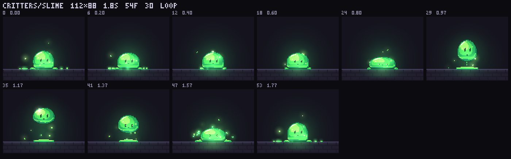
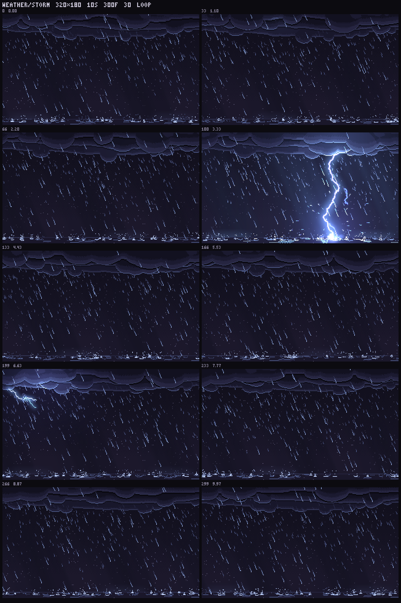
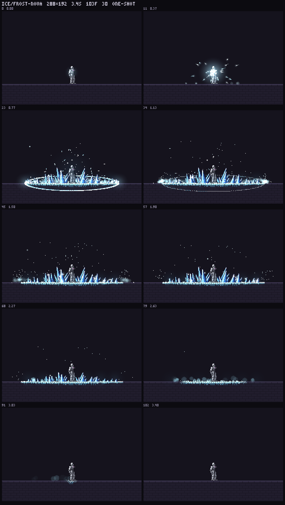

# dsh-art

> 给 DeepSeek Harness（DSH）用的美术素材包插件。**18 个工具、三个数据源**：
> 341 种「代码动画」风格提示词（193 张参考静帧）、一个可选的参考图库客户端、
> 244 条带源码与预览的像素特效。零运行时依赖，装完直接在会话里用。

| | 内容 | 工具 |
|---|---|---|
| **① 本地素材库** | 341 条风格提示词 / 193 张静帧 / 10 个系列 / 3 个示例视频 | `anim_list_series` `anim_search` `anim_show` `anim_still` `anim_export` `anim_random` `anim_guide` |
| **② 参考图库**（可选） | 8,496 张参考图（自建的只读 JSON API，地址自己配） | `anim_ref_sources` `anim_ref_search` `anim_ref_show` `anim_ref_pick` |
| **③ pixelfx 特效** | 244 条像素特效 / 21 个分类 / 244 张预览 / 源码可导出 | `anim_fx_stats` `anim_fx_search` `anim_fx_show` `anim_fx_preview` `anim_fx_export` `anim_fx_random` `anim_fx_guide` |

上：`critters/slime`（112×80，1.8s 循环）／`weather/storm`（320×180 全屏）／`ice/frost-nova`（288×192，3.4s 单次，带角色表演）——三张都是 `anim_fx_preview` 现场渲染出来的接触表

---

## 1. 一分钟装进 DSH

~~~bash
git clone https://github.com/Liaoyun666/dsh-art.git
cd dsh-art

node tools/install.mjs            # 建 junction + 把补丁层登记进 desktop profile
node tools/install.mjs --status   # 自检：模块能不能加载、三个数据源各有多少条
node tools/verify.mjs             # 117 项检查（纯离线，不用联网）
~~~

装完刷新 DSH 页面（profile 是 `patchReload: live`，新工具立刻出现），在会话里说一句
「用 anim_list_series 看看有哪些系列」就该看到东西了。

- 换 profile：`node tools/install.mjs <profile名>`（缺省 `desktop`，可写绝对路径）。
- 卸载：`node tools/install.mjs --uninstall`。
- 要求 Node ≥ 22；DSH 桌面端自带的 node 也能跑。
- 插件本体零依赖 —— 没有 `dependencies`，`npm install` 都不用跑。

## 2. 十八个工具

### 本地素材库（7）

| 工具 | 作用 |
|---|---|
| `anim_list_series` | 列出 10 个系列与条目数，先看家底 |
| `anim_search` | 按关键词 / 系列检索 341 条（多个词＝同时命中，支持直接填编号 `B3`） |
| `anim_show` | 读某条的完整提示词（Markdown 原文）＋参考静帧路径 |
| `anim_still` | 只取参考静帧图片路径，可直接交给看图工具 |
| `anim_export` | 把提示词（可带静帧）复制到工作目录 `anim-styles/<编号>_<名称>/` |
| `anim_random` | 随便抽一条（可限定系列），找灵感用 |
| `anim_guide` | 读出完整使用指南（选型、占位符、时间接口、验收清单） |

### 参考图库（4，需要自己有一台）

| 工具 | 作用 |
|---|---|
| `anim_ref_sources` | 看库的家底：多少张图 / 来源 / 分类 / 配色聚类 / 授权 |
| `anim_ref_search` | 按中英文关键词、分类、来源、聚类检索，可顺手下载到本地 |
| `anim_ref_show` | 看某一张的元信息、授权、各尺寸地址，默认下载到本地 |
| `anim_ref_pick` | 随机抽几张参考图，带回本地路径 |

地址按 **`config.refBase` → 环境变量 `DSH_REF_BASE` → 占位地址 `http://127.0.0.1:8080`** 取，代码里不写死。
**没有自建库时这四条会如实说「没连上」，不影响其余 14 个工具。**
参考图库本身是另一个项目（纯静态站 + 一个只读 JSON API），不在本仓库里。

### pixelfx 像素特效（7）

| 工具 | 作用 |
|---|---|
| `anim_fx_stats` | 244 条的家底：分类分布、多少带角色、多少循环、像素尺寸区间 |
| `anim_fx_search` | 按关键词 / 分类 / 循环 / 角色检索（`fire`、`爆炸`、`界面` 都认） |
| `anim_fx_show` | 一条的完整说明：尺寸、时长、可调色带、`act` 表演时间轴、接入代码，`source: true` 再附源码 |
| `anim_fx_preview` | 给出接触表 PNG 的本地绝对路径（一次最多 12 条），直接看 |
| `anim_fx_export` | 把那几条（或某分类前 N 条）连同 `src/core` 与渲染工具复制成**能直接跑**的小项目 |
| `anim_fx_random` | 随机抽一条（可限定分类 / 循环 / 角色） |
| `anim_fx_guide` | 完整指南：七条工具怎么串、导出目录树、游戏里怎么接、精灵表怎么给非 JS 引擎 |

## 3. 三条典型流程

### 流程一：一句话 → 一段过场动画

~~~text
你：帮我做一个「霓虹雨夜，镜头推近，最后定格在招牌」的过场
→ anim_search "霓虹 雨夜"        （找到 R1_霓虹雨夜·电影感 这类条目）
→ anim_show R1                   （读完整提示词 + 静帧路径）
→ anim_still R1                  （看一眼参考静帧，确认调性对得上）
→ anim_export R1                 （落到 ./anim-styles/R1_霓虹雨夜·电影感/）
→ 照 docs/rendering.md 用 window.renderAt(t) + playwright/ffmpeg 导 MP4
→ anim_guide                     （对着验收清单自检：时间轴、字重、构图、循环）
~~~

### 流程二：游戏里要一套攻击特效

~~~text
你：给剑士做一套攻击特效，要能放进像素游戏
→ anim_fx_stats                  （244 条 / 21 分类，先看有哪些）
→ anim_fx_search "slash 劈砍"     （或直接 category: melee）
→ anim_fx_preview ids=[…]        （接触表 PNG，挑 2~3 条）
→ anim_fx_show melee/sword-slash （136×104、0.75s 单次、8 个姿态关键帧、7 档色带）
→ anim_fx_export ids=["melee/sword-slash"]   （→ ./pixelfx-fx/，23 个文件）
cd pixelfx-fx
node tools/render.mjs melee/sword-slash --zoom 2        # 接触表
node tools/render.mjs melee/sword-slash --sheet         # 精灵表 PNG + JSON
~~~

精灵表的 JSON 里带 `meta.pixelfx.act`：蓄力时长、每个打击点的时间/顿帧/震屏/击退/换皮时刻
——**非 JS 引擎（Unity / Godot / 自研）照着这个时间轴接就行，不用读 JS。**

### 流程三：自己扩库

- **加风格**：在 `assets/library/风格提示词/<系列>/` 下放一对文件（`X9_名称.md` + `X9_名称.jpg`），
  同步 `assets/library/_统计.json`，然后 `node tools/verify.mjs` 会把对不上的地方指出来。
- **加特效**：特效源码不在本仓库，在 `pixelfx/` 镜像里：

~~~bash
git clone https://github.com/patch-gg/pixelfx.git pixelfx   # 放在本仓库根下即可被自动找到
node tools/build-fx.mjs --previews                          # 重建索引 + 预览
node tools/verify.mjs                                       # 这次会多跑 6 项源码检查
~~~

## 4. 目录结构

~~~text
dsh-art/
├── package.json              # DSH bundle 声明（dsh.bundle.patch）
├── cordis.patch.yml          # 补丁层片段：- insert: [{id: anim-pack, name: dsh-anim-pack}]
├── lib/
│   ├── index.js              # 插件入口：18 个工具注册、配置规范化、渲染成文本卡片（900 行）
│   ├── catalog.js            # 本地素材库：索引加载 / 检索 / 抽读 / 导出（164 行）
│   ├── refs.js               # 参考图库客户端：搜索 / 详情 / 下载（289 行）
│   └── fx.js                 # 特效库：索引加载 / 检索 / 源码 / 导出小项目（403 行）
├── assets/
│   ├── catalog.json          # 341 条风格索引（脚本生成，别手改）
│   ├── library/              # 341 条提示词 md + 193 张静帧 + 示例 + 第三方许可
│   │   ├── 风格提示词/        #   A-G / H / K / L / M / O / R / V / X / Z 十个系列
│   │   ├── 示例/              #   B6、X7 两组：提示词 + 两个模型的成片 MP4 + 截图
│   │   ├── 第三方许可/        #   三份 MIT 原文
│   │   ├── 许可与来源.md      #   素材包本身的使用条款（重要，见第 7 节）
│   │   └── 风格挑选.html      #   一页看全 341 条的小工具
│   └── fx/
│       ├── catalog.json      # 244 条特效索引（tools/build-fx.mjs 生成）
│       └── previews/         # 244 张接触表 PNG（每条一张）
├── tools/
│   ├── install.mjs           # 装 / 卸 / 自检（junction + 托管补丁块）
│   ├── verify.mjs            # 自检（有镜像 117 项，无镜像 111 项；--refs 再加 12 项联网）
│   └── build-fx.mjs          # 从 pixelfx 镜像重建特效索引与预览
├── docs/
│   ├── fx.md                 # 特效库指南（导出后怎么用、怎么给非 JS 引擎）
│   ├── SKILL.md              # 给 Claude Code / Codex 一类 agent 的技能描述
│   ├── attribution.md        # 素材与第三方致谢明细
│   ├── rendering.md          # 代码动画的时间接口与录 MP4
│   └── AUDIT.md              # 本项目的审查报告（优点、风险、已知限制）
└── .github/workflows/verify.yml
~~~

仓库现实：**819 个文件 / 98.8 MB**（三个示例 MP4 就占 59.9 MB，244 张预览 23.9 MB，193 张静帧 12.2 MB）。
clone 慢是这个原因，不是代码。

## 5. 配置（七个键）

写在 profile 的 `cordis.patch.yml` 里 `dsh-anim-pack` 那一行下面：

~~~yaml
- insert:
    - id: anim-pack
      name: dsh-anim-pack
      config:
        libraryPath: <换成别的素材库>
        exportDir: <默认 <cwd>/anim-styles>
        refBase: <参考图库地址>
        refCacheDir: <参考图缓存目录>
        refTimeoutMs: 20000
        fxPath: <pixelfx 镜像位置>
        fxExportDir: <默认 <cwd>/pixelfx-fx>
~~~

七个键全部可选，不填走缺省。`fxPath` 的解析顺序是：配置值 → 索引里记的相对路径 → 插件根下的 `pixelfx/`。
改完刷新页面生效。

## 6. 自检

~~~bash
node tools/verify.mjs                                      # 离线：有镜像 117 项 / 无镜像 111 项
DSH_REF_BASE=http://你的库 node tools/verify.mjs --refs     # 再加 12 项联网
~~~

覆盖：18 个工具是否都注册、每个工具是否真能跑、341/193/10 与 244/21/244 的计数与磁盘文件是否一致、
索引里的 id 是否都能查到源文件、检索排序、导出是否拒绝写进库内、特效能否在临时目录里真的渲出图，
以及「镜像不在时」的降级路径（要给人话，不能崩）。CI（`.github/workflows/verify.yml`）每次 push 跑一遍。

## 7. 许可（三种，别混）

| 范围 | 许可 |
|---|---|
| **代码**（`lib/` `tools/` `docs/` `package.json` `cordis.patch.yml`） | **MIT**，见 [LICENSE](LICENSE) |
| **素材**（`assets/library/`：341 条提示词与 193 张静帧） | 原条款：可免费使用、可免费转发；**禁止包装成课程 / 付费 skills 或其他收费物出售**；来自开源项目的部分保留原许可与署名 |
| **pixelfx**（`assets/fx/`，上游 `patch-gg/pixelfx`） | **MIT**；其中 `sim.js` 与约 180 个特效改编自 Sprite Fusion（© 2026 Hugo Duprez），`act.js` 改编自 Hollow Crown —— 署名见 [NOTICE.md](NOTICE.md) |

注意：pixelfx 上游 `gallery/` 里那个 `PatchPixel` 网页字体**不是 MIT**（© Patch，保留所有权利）；
本仓库**不包含**该字体文件，244 张预览图里的字是渲染工具内置的点阵字体画的。

## 8. 审查结论

详细报告：[docs/AUDIT.md](docs/AUDIT.md)。一句话版：

- **能用、可维护**：模块边界清楚（catalog / refs / fx 各管一个数据源）、零依赖、错误信息是人话、
  导出有防呆（拒绝往库内写）、服务地址不写死。
- **测试是真的**：117 项自检里包含「在临时目录里真导出一个小项目并渲出一张图」，不只是断言文件存在。
- **风险**：① `lib/index.js` 900 行，单文件偏大；② 没有 lint / 类型检查；
  ③ 仓库 98.8 MB（三个示例 MP4 占 59.9 MB）；④ 特效索引依赖外部 pixelfx 镜像；
  ⑤ 特效按 24×38 的人物尺度画，放大会糊。
- 改进建议与验收记录都在 AUDIT 里。

## 9. 致谢

- 像素特效与创作方法论：**Sprite Fusion / Hugo Duprez**（`pixel-art-vfx`，MIT）与其
  "reference first → one line → render and look" 的做法。
- 角色表演层：**Hollow Crown**（`rehan-remade/hollow-crown`，MIT）。
- 风格提示词里来自开源项目的部分：**code-video**（© 2026 Bae-ChangHyun）、
  **Lemo-Opuscar**（© 2026 LemoLab）、**mg-styles-15**（© 2026 Vincentwei1021），均 MIT。
- 宿主平台：**DeepSeek Harness**。

---

## English

**dsh-art** is an art asset pack plugin for DeepSeek Harness. It registers **18 `anim_*` tools** over three
data sources: 341 code-animation style prompts (with 193 reference stills), an optional art-reference library
client, and 244 pixel-art effects with source and rendered previews. Zero runtime dependencies.

~~~bash
git clone https://github.com/Liaoyun666/dsh-art.git && cd dsh-art
node tools/install.mjs        # junction into the DSH profile + patch entry
node tools/verify.mjs         # 117 offline checks (111 without the pixelfx mirror)
~~~

Code is MIT. The prompt library under `assets/library/` keeps its own terms (free to use and share, not to be
resold as a course or paid skill pack). Effects are MIT via `patch-gg/pixelfx`. See [NOTICE.md](NOTICE.md).
