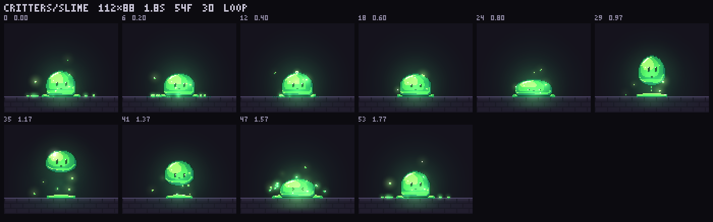
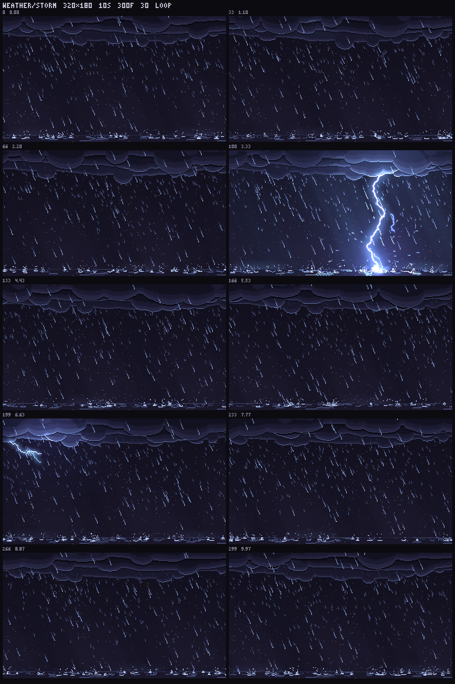
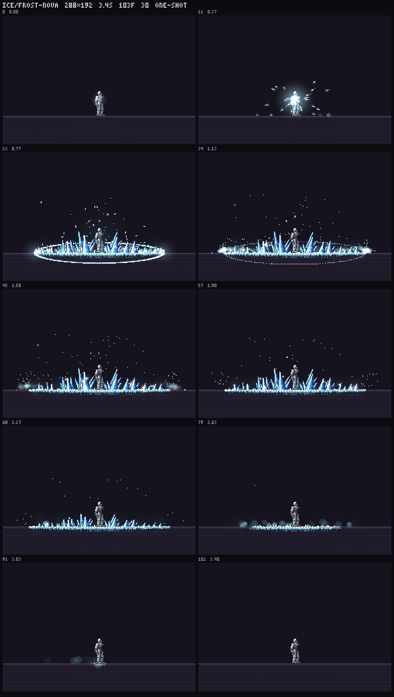
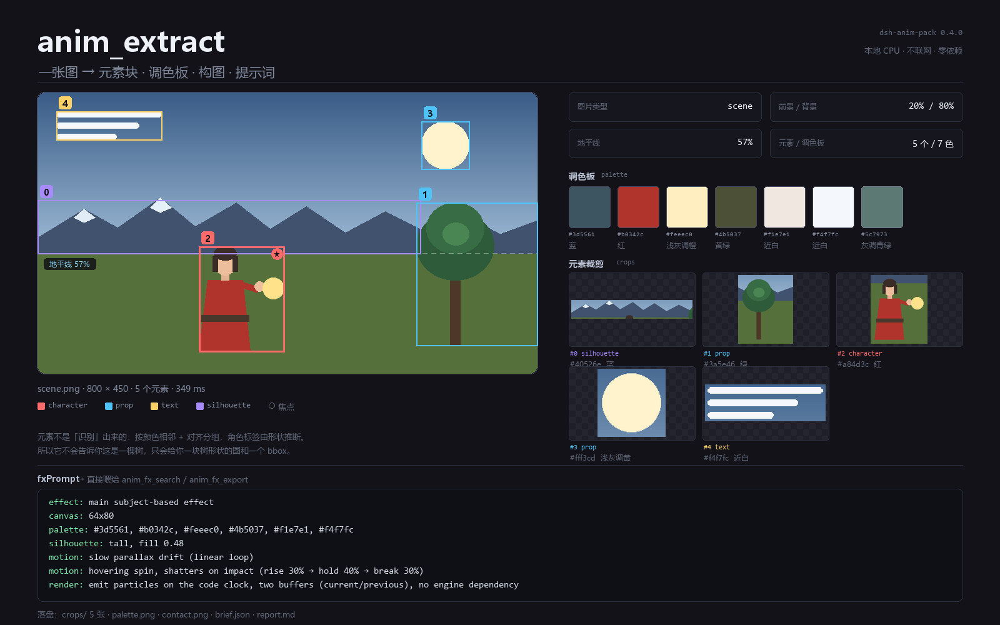

# dsh-art

> 公开仓：<https://github.com/Liaoyun666/dsh-art>（代码 MIT；`assets/` 下素材另按 [NOTICE.md](https://github.com/Liaoyun666/dsh-art/blob/main/NOTICE.md)）
>
> 给 DeepSeek Harness（DSH）用的美术素材包插件。**36 个工具、七个数据源、一个路由**：
> 341 种「代码动画」风格提示词（193 张参考静帧）、一个可选的参考图库客户端、
> 244 条带源码与预览的像素特效、**把你自己那张图拆成元素块、配色和提示词**的本地提取器、
> 124 张视频镜头配方卡（video-shotcraft，含 54 张海报），
> 一套**设计工艺库**（8 条美学锚点 / 24 条可抄的 CSS 版式模式 / 15 条可用性审查准则），
> 以及一个**外接素材库**：liaoyunart.com 的 16,900+ 条实拍 / 绘画 / 图标 / 贴图（21 个来源、30 个分类、每张带授权），
> 加 Iconify 的 20 万+ 图标、ambientCG 的 2,900+ PBR 材质、Poly Haven 的 HDRI / 贴图 / 模型，一共登记 13 家。
> 外加一个 `anim_design_brief` 路由：做前端 / 界面 / 海报之前一次调用，把风格、镜头、特效、工艺、配色揉成一份能照着做的参考包。零运行时依赖，装完直接在会话里用。

| | 内容 | 工具 |
|---|---|---|
| **① 本地素材库** | 341 条风格提示词 / 193 张静帧 / 10 个系列 / 3 个示例视频 | `anim_list_series` `anim_search` `anim_show` `anim_still` `anim_export` `anim_random` `anim_guide` |
| **② 参考图库**（可选） | 8,496 张参考图（自建的只读 JSON API，地址自己配） | `anim_ref_sources` `anim_ref_search` `anim_ref_show` `anim_ref_pick` |
| **③ pixelfx 特效** | 244 条像素特效 / 21 个分类 / 244 张预览 / 源码可导出 | `anim_fx_stats` `anim_fx_search` `anim_fx_show` `anim_fx_preview` `anim_fx_export` `anim_fx_random` `anim_fx_guide` |
| **④ 元素提取**（本机跑） | 你手里那一张图 → 元素块 / 调色板 / 构图 / 两段提示词 | `anim_extract` `anim_extract_guide` |
| **⑤ 镜头配方卡** | 124 张卡 / 10 分类 / 150 个镜头风格 / 54 张海报（video-shotcraft，Apache-2.0） | `anim_shot_stats` `anim_shot_search` `anim_shot_show` `anim_shot_preview` `anim_shot_export` `anim_shot_random` `anim_shot_guide` |
| **⑥ 设计工艺库** | 8 条美学锚点（各锁六个 token）/ 24 条 CSS 版式模式 / 15 条审查准则 + 反 AI 味规则 | `anim_design_anchors` `anim_design_patterns` `anim_design_audit` |
| **⑦ 外接素材库** | 13 个来源登记（4 家可检索取图）：liaoyunart 16,900+ 条 / Iconify 20 万+ 图标 / ambientCG 2,900+ 材质 / Poly Haven 998 HDRI | `anim_asset_sources` `anim_asset_search` `anim_asset_show` `anim_asset_fetch` `anim_asset_guide` |
| **⑧ 设计路由**（入口） | 一次调用：3 条风格 + 3–6 张镜头卡 + 2 条锚点 + 像素特效 + 配色/版式/动效预算 | `anim_design_brief` |

上：`critters/slime`（112×80，1.8s 循环）／`weather/storm`（320×180 全屏）／`ice/frost-nova`（288×192，3.4s 单次，带角色表演）——三张都是 `anim_fx_preview` 现场渲染出来的接触表

---

## 1. 一分钟装进 DSH

~~~bash
git clone https://github.com/Liaoyun666/dsh-art.git
cd dsh-art

node tools/install.mjs            # 建 junction + 把补丁层登记进 desktop profile
node tools/install.mjs --status   # 自检：模块能不能加载、七个数据源各有多少条
node tools/verify.mjs             # 298 项检查（纯离线，不用联网）
node tools/verify.mjs --assets    # 再加 9 项：真拉 liaoyunart 目录、中文检索、批量落盘、四家各搜一条
~~~

装完刷新 DSH 页面（profile 是 `patchReload: live`，新工具立刻出现），在会话里说一句
「用 anim_list_series 看看有哪些系列」就该看到东西了。

- 换 profile：`node tools/install.mjs <profile名>`（缺省 `desktop`，可写绝对路径）。
- 卸载：`node tools/install.mjs --uninstall`。
- 要求 Node ≥ 22；DSH 桌面端自带的 node 也能跑。
- 插件本体零依赖 —— 没有 `dependencies`，`npm install` 都不用跑。

## 2. 三十六个工具

### 本地素材库（7）

| 工具 | 作用 |
|---|---|
| `anim_list_series` | 列出 10 个系列与条目数，先看家底 |
| `anim_search` | 按关键词 / 系列检索 341 条（多个词＝同时命中，支持直接填编号 `B3`） |
| `anim_show` | 读某条的完整提示词（Markdown 原文）＋参考静帧路径 |
| `anim_still` | 只取参考静帧图片路径，可直接交给看图工具 |
| `anim_export` | 把提示词（可带静帧）复制到工作目录 `anim-styles/<编号>_<名称>/` |
| `anim_random` | 随便抽一条（可限定系列），找灵感用 |
| `anim_guide` | 读出完整使用指南（选型、占位符、时间接口、验收清单） |

### 参考图库（4，需要自己有一台）

| 工具 | 作用 |
|---|---|
| `anim_ref_sources` | 看库的家底：多少张图 / 来源 / 分类 / 配色聚类 / 授权 |
| `anim_ref_search` | 按中英文关键词、分类、来源、聚类检索，可顺手下载到本地 |
| `anim_ref_show` | 看某一张的元信息、授权、各尺寸地址，默认下载到本地 |
| `anim_ref_pick` | 随机抽几张参考图，带回本地路径 |

地址按 **`config.refBase` → 环境变量 `DSH_REF_BASE` → 占位地址 `http://127.0.0.1:8080`** 取，代码里不写死。
**没有自建库时这四条会如实说「没连上」，不影响其余 30 个工具。**
参考图库本身是另一个项目（纯静态站 + 一个只读 JSON API），不在本仓库里。

### pixelfx 像素特效（7）

| 工具 | 作用 |
|---|---|
| `anim_fx_stats` | 244 条的家底：分类分布、多少带角色、多少循环、像素尺寸区间 |
| `anim_fx_search` | 按关键词 / 分类 / 循环 / 角色检索（`fire`、`爆炸`、`界面` 都认） |
| `anim_fx_show` | 一条的完整说明：尺寸、时长、可调色带、`act` 表演时间轴、接入代码，`source: true` 再附源码 |
| `anim_fx_preview` | 给出接触表 PNG 的本地绝对路径（一次最多 12 条），直接看 |
| `anim_fx_export` | 把那几条（或某分类前 N 条）连同 `src/core` 与渲染工具复制成**能直接跑**的小项目 |
| `anim_fx_random` | 随机抽一条（可限定分类 / 循环 / 角色） |
| `anim_fx_guide` | 完整指南：七条工具怎么串、导出目录树、游戏里怎么接、精灵表怎么给非 JS 引擎 |

### 元素提取（2，纯本地 CPU）

| 工具 | 作用 |
|---|---|
| `anim_extract` | 把一张图拆开：`crops/` 元素块、`palette.png`、`contact.png` 接触表、`brief.json`、`report.md`，并在会话里给一张卡片（类型、构图、地平线、元素表、两段提示词） |
| `anim_extract_guide` | 完整说明：到底量了什么、四类图（场景 / 装裱 / 无缝贴图 / 精灵表）怎么用、八个参数、输出树、「别当真的事」 |

支持 PNG / JPEG / GIF / BMP / TGA；WebP / HEIC 不解码，要用户先另存 PNG。
像素画会先认出倍率（4×/8×…）再按真实尺寸分析，裁剪块按整数倍放大，不会糊。

上面这张是按同一次提取结果排版的设计图（不是终端截图）：左图上的 5 个元素框与地平线、右上的类型／前景背景／地平线／元素数、右上 7 色调色板、右下的 <code>crops/</code> 裁剪块、底部的 <code>fxPrompt</code>，全部来自 <code>anim_extract</code> 对 <code>assets/extract/scene.png</code> 的真实输出（800×450，349 ms）。原图也在这个目录里，可以拿去自己跑一遍。

### 镜头配方卡（7）

来自 [Vincentwei1021/video-shotcraft](https://github.com/Vincentwei1021/video-shotcraft)（Apache-2.0）：
不是视频生成模型，而是 **124 张「这一幕怎么动」的施工图**——意图、动效核心、参数表、声音、已知坑，
外加去上游取 Remotion 实现的路径。

| 工具 | 作用 |
|---|---|
| `anim_shot_stats` | 124 张卡的家底：10 分类各多少张 / 多少风格 / 多少海报，能量分布，上游与在线样片地址 |
| `anim_shot_search` | 按关键词 / 分类 / 标签 / 能量 / 有无海报检索；关键词默认进正文（`deep: false` 只搜元信息） |
| `anim_shot_show` | 一张卡的全文：摘要 + 意图 / 动效核心 / 参数表 / 声音 / 已知坑 / 参考实现 |
| `anim_shot_preview` | 给出海报 JPG 的本地路径（一次最多 12 张），没配图的卡如实说明 |
| `anim_shot_export` | 把卡 + 海报复制成 `<卡名>/` 目录（md + jpg + README），再写一份 `index.md` 总表 |
| `anim_shot_random` | 随机抽一张（可限定分类 / 标签 / 能量 / 有海报） |
| `anim_shot_guide` | 完整指南：卡里有什么、十类怎么分工、从挑卡到成片、和另外四组怎么搭、许可与维护 |

十类：`opening` 开场与品牌 11、`camera` 运镜与空间 10、`transition` 转场 15、
`typography` 文字与字卡 22、`ui-entrance` 界面登场 21、`interaction` 交互演示 11、
`data` 数据与指标 5、`effects` 光效与强调 15、`rhythm` 节奏与蒙太奇 8、`outro` 收尾 6。
本插件只带卡与海报，**不带 Remotion 工程、样片、音效与 BGM**；卡里的「参考实现」写着去上游取代码的相对路径。

### 外接素材库（5，联四家 / 登记九家）

素材本体**不随包发**——插件只提供一个统一的检索口，四家能直接查、直接取图，
另外九家只登记入口与授权（它们是「外接」，不是「集成」，工具会如实说明）：

| 源 | 能做什么 | 授权 |
|---|---|---|
| **liaoyunart.com**（自建库） | 16,907 条：实拍 / 绘画 / 版画 / 图标 / 像素 / 贴图 / 色板 / 航天影像，21 个来源、30 个分类、16 个配色聚类；每条带来源页、作者、年代、主色板、标签 | 逐条标（CC0 / 署名 / 非商业 / 不明），36 条授权文案 |
| **Iconify** | 196 个图标集、20 万+ 图标，按词检索后取 SVG（可换颜色） | 按集合，多数 MIT / CC BY / Apache |
| **ambientCG** | 2,939 套 CC0 PBR 材质，检索 + 取 1K–8K 贴图包 | CC0 |
| **Poly Haven** | 998 张 HDRI / 871 张纹理 / 522 个模型，检索 + 取文件 | CC0 |
| 另外九家 | Kenney、OpenGameArt、LottieFiles、game-icons、Google Fonts、Hero Patterns、Transparent Textures、Lospec、unDraw：只给主页、能拿到什么、授权，插件不代抓 | 各不相同，见 [docs/assets.md](docs/assets.md) |

| 工具 | 作用 |
|---|---|
| `anim_asset_sources` | 13 个登记源的家底：哪些能检索、哪些只给入口、liaoyunart 的规模 / 分类 / 来源 / 配色聚类 / 授权分布 |
| `anim_asset_search` | 按关键词 + 分类 / 来源 / 分组 / 种类 / 色调 / 聚类 / 授权 / 排序检索；中文词自动换英文同义词（水墨→ink），中文多词可部分命中兜底；结果带本页区间与本页授权分布；`provider: "all"` 一次查四家 |
| `anim_asset_show` | 一条素材的全部元信息：授权与可用性判断、主色板、各尺寸直链、来源页；`download: true` 顺手落盘 |
| `anim_asset_fetch` | 把原图 / 贴图 / SVG 下载到指定目录（.part 原子改名，80 MB 上限，命中缓存复用）；`ids: [...]` 一次批量落最多 12 条 |
| `anim_asset_guide` | 指南：四步走、授权纪律（做交付物时按这个判）、离线与自建镜像 |

liaoyunart 的目录是一份 11.6 MB 的 `data/catalog.js`，首次拉下来落进
`~/.dsh/cache/anim-pack-assets/liaoyunart-catalog.json`，之后**离线也能搜**（7 天算新，过期了下次联网顺手刷新）。
地址按 **`config.assetBase` → 环境变量 `DSH_ASSET_BASE` → `https://liaoyunart.com`** 取，可以指向自己的镜像。
授权不明的条目工具会直接写「别直接进交付物，只当参考」——这条纪律请当真，[docs/assets.md](docs/assets.md) 里写清楚了怎么判。

**中文检索**：liaoyunart 的标题 / 标签全是英文，直接搜「水墨」「材质」原来会 0 命中。1.0.1 起内置一张
中→英同义词表（墨→ink、山水→landscape、材质→material、图标→icon、箭头→arrow…约 110 个词）：
同义词组内任一命中即可、组与组之间仍要同时满足；中文查询一个都没全命中时，退一步给「命中一半以上」的条目并标
`relaxed`，英文查询保持严格（不会因为放宽而误命中）。挑好一批图用
`anim_asset_fetch(ids=["…","…"])` 一次落盘（最多 12 条），不用一条条来回调。

### 设计工艺库（3，定调 / 抄版式 / 交付前自检）

随包发在 `assets/design/`，不联网、不下载。数据是按三个 MIT 项目的要点**重写的中文 JSON**，
不是原文件复制（署名见 [NOTICE.md](NOTICE.md) 第 6 节）：

| 工具 | 作用 |
|---|---|
| `anim_design_anchors` | 8 条美学锚点（瑞士、工业终端、粗野、极光、混沌极繁、复古未来、有机、低保真），每条锁死底色 / 字体 / 强调色 / 结构 / 质感 / 动效，并列「会破的写法」。整页只锁一个；传 `query` 读完整卡 |
| `anim_design_patterns` | 24 条可直接抄的 CSS 模式（非对称栅栏、悬停抬升、3D 倾斜、毛玻璃、整屏吸附、明暗交替、描边空心字、差值混合、无跳动锁滚动…），每条给「为什么 / 什么时候用 / CSS」；关键词也搜 CSS 正文 |
| `anim_design_audit` | 15 条可用性准则 + 0–4 严重度 + 15 条反 AI 味 + 内容纪律 + 工艺底线。交付前跑一次，先修 ≥3 分的；传 `focus` 只展开一条 |

配套规则数据（5 套配色原型、5 组字体配对、5 档动效时长、流式字号与间距）不单独开工具，
由 `anim_design_brief` 与 `anim_design_audit` 带出。指南见 [docs/design-library.md](docs/design-library.md)。

### 前端设计参考包（1，做界面时从这里进）

写页面、界面、看板、游戏 HUD、海报、PPT 之前先调它一次，别凭空写样式：

| 工具 | 作用 |
|---|---|
| `anim_design_brief` | 输入 `task`（必填）＋可选 `surface`（web-landing / dashboard / app / game-ui / deck / promo / illustration）、`mood`、`palette`、`motion`、`limit`，输出「① 定调 3 条风格 ② 动效配方 3–6 张镜头卡 ③ 1–2 条美学锚点 ④ 现成像素素材 ⑤ 配色原型（变量脚手架）+ 版式模式 + 动效硬指标 ⑥ 下一步调用顺序」，并且每条都带可直接照抄的 `anim_show(id="…")` / `anim_shot_show(id="…")` / `anim_design_anchors(query="…")` 调用 |

它不新造数据，只把上面六组随包数据源按场景重新排一遍：先从任务描述里拆关键词（中英文都认），
再按场景给镜头卡分类、特效分类、版式模式加权，最后配一套 60/30/10 的配色与四条动效硬指标。
只读参考、不写文件；深读仍然走 `anim_show` / `anim_shot_show` / `anim_fx_show` / `anim_design_* `。

安装器会顺手写一份伴随技能 `~/.agents/skills/frontend-art-reference/SKILL.md`，
让模型在「做前端 / 界面 / 海报」时想起这条入口（卸载时一并撤掉，手写的同名技能不会被覆盖删除）。

### 网页里的卡片（36 个工具都有）

在 DSH 网页端，每个 `anim_*` 调用是一张自己的卡片，不再是写着「工具调用」的通用行：

- **行**：家族图标 + 中文标题 + 关键参数 + 结果规模。例如 `🎬 检索镜头卡 · 墨线 开场 · 图 6`，失败时多一个红色「失败」。
- **展开**：参数 chips、图片墙（预览拼图 / 海报 / 缩略图直接出图，点一下开原图）、正文（正文里的绝对路径是可点链接，点了直接开文件）。
- 失败自动展开，正常结果默认折叠，不打断阅读。

| 图标 | 家族 | 工具 |
|---|---|---|
| 🔍 | 检索 | `anim_search` `anim_fx_search` `anim_ref_search` `anim_shot_search` `anim_asset_search` |
| 📄 | 详情 | `anim_show` `anim_fx_show` |
| 🖼 | 静帧 / 海报 / 参考图 / 素材 | `anim_still` `anim_shot_preview` `anim_ref_show` `anim_asset_show` |
| ⬇ | 下载 | `anim_asset_fetch` |
| 🎞 | 预览图 | `anim_fx_preview` |
| 🎲 | 随机 | `anim_random` `anim_fx_random` `anim_ref_pick` `anim_shot_random` |
| 📦 | 导出 | `anim_export` `anim_fx_export` `anim_shot_export` |
| 📊 | 概况 | `anim_fx_stats` `anim_shot_stats` |
| 🗂 | 系列 / 图库 / 素材源 | `anim_list_series` `anim_ref_sources` `anim_asset_sources` |
| 🧩 | 元素提取 | `anim_extract` |
| 🎨 | 设计工艺 | `anim_design_brief` `anim_design_anchors` `anim_design_patterns` `anim_design_audit` |
| 📘 | 指南 | `anim_guide` `anim_fx_guide` `anim_extract_guide` `anim_shot_guide` `anim_asset_guide` |

实现只用了一个宿主扩展点和一个只读接口：

- `tool.call.toolview` 插槽，按 wire 名注册（`key: "anim_fx_preview"`），命中即替换整行，所以卡片自己负责运行中 / 失败 / 折叠这几种形态；
- `GET /api/file?path=<绝对路径>`，本地图片由 DSH 自己鉴权后返回，前端直接 `` 即可，不用把图读成 base64。

样式全部走宿主 CSS 变量（`--dsw-alias-*` / `--dsh-content-*`），明暗主题自动跟随，没有硬编码底色；
除 `react` 外零依赖，也没有构建步骤——`lib/client.js` 就是手写的浏览器 bundle。

改完 `lib/client.js` 需要**重启 DSH** 才会加载（客户端 bundle 在启动时编入）。`node tools/verify.mjs` 里有一组离线检查会把这份 bundle 在假环境里跑一遍，防止语法错或漏注册。

## 3. 七条典型流程

### 流程一：一句话 → 一段过场动画

~~~text
你：帮我做一个「霓虹雨夜，镜头推近，最后定格在招牌」的过场
→ anim_search "霓虹 雨夜"        （找到 R1_霓虹雨夜·电影感 这类条目）
→ anim_show R1                   （读完整提示词 + 静帧路径）
→ anim_still R1                  （看一眼参考静帧，确认调性对得上）
→ anim_export R1                 （落到 ./anim-styles/R1_霓虹雨夜·电影感/）
→ 照 docs/rendering.md 用 window.renderAt(t) + playwright/ffmpeg 导 MP4
→ anim_guide                     （对着验收清单自检：时间轴、字重、构图、循环）
~~~

### 流程二：游戏里要一套攻击特效

~~~text
你：给剑士做一套攻击特效，要能放进像素游戏
→ anim_fx_stats                  （244 条 / 21 分类，先看有哪些）
→ anim_fx_search "slash 劈砍"     （或直接 category: melee）
→ anim_fx_preview ids=[…]        （接触表 PNG，挑 2~3 条）
→ anim_fx_show melee/sword-slash （136×104、0.75s 单次、8 个姿态关键帧、7 档色带）
→ anim_fx_export ids=["melee/sword-slash"]   （→ ./pixelfx-fx/，23 个文件）
cd pixelfx-fx
node tools/render.mjs melee/sword-slash --zoom 2        # 接触表
node tools/render.mjs melee/sword-slash --sheet         # 精灵表 PNG + JSON
~~~

精灵表的 JSON 里带 `meta.pixelfx.act`：蓄力时长、每个打击点的时间/顿帧/震屏/击退/换皮时刻
——**非 JS 引擎（Unity / Godot / 自研）照着这个时间轴接就行，不用读 JS。**

### 流程三：自己扩库

- **加风格**：在 `assets/library/风格提示词/<系列>/` 下放一对文件（`X9_名称.md` + `X9_名称.jpg`），
  同步 `assets/library/_统计.json`，然后 `node tools/verify.mjs` 会把对不上的地方指出来。
- **加特效**：特效源码不在本仓库，在 `pixelfx/` 镜像里：

~~~bash
git clone https://github.com/patch-gg/pixelfx.git pixelfx   # 放在本仓库根下即可被自动找到
node tools/build-fx.mjs --previews                          # 重建索引 + 预览
node tools/verify.mjs                                       # 这次会多跑 6 项源码检查
~~~

### 流程四：手里只有一张图

~~~text
你：这张截图感觉不错，照着它做一段
→ anim_extract C:\art\scene.png     （拆元素、出 crops/ 与 brief.json）
→ 看一眼 contact.png                （切得对不对，一目了然）
→ 要出图：把「生图提示词」交给图像模型
→ 要代码：把「特效提示词」(canvas + palette) 喂给 anim_fx_search，找相近特效改写
→ 要贴图：直接用 crops/NN-<role>.png（透明背景，可当精灵或底图）
~~~

它做的是**按颜色与轮廓分割**，不是物体识别：角色可能被拆成头／身／腿，
也可能和背景并成一块。角色标签是启发式的，报告里已如实写明。

### 流程五：照着镜头卡拍一条产品片

~~~text
你：给这个 App 做一条 20 秒的宣传片，先出分镜
→ anim_shot_stats                        （124 张卡 / 10 分类，先看有哪些）
→ anim_shot_search category="opening"     （开场候选，看一句话与时长）
→ anim_shot_preview ids=[…]              （海报挑 2~3 张，确认观感）
→ anim_shot_show opening/brand-ink-open  （读意图、动效核心、参数表、已知坑）
→ anim_shot_export ids=[…] dir="storyboards/1113"   （每张卡一个目录 + index.md）
→ 要代码：照卡里「参考实现」的路径去 video-shotcraft 的 demos/ 取 Remotion 组件
→ 要美术：把卡的关键词丢给 anim_search / anim_ref_search 找风格与参考图
~~~

### 流程六：做前端页面之前先取参考

~~~text
你：做一个深色科技风的 AI 写作产品落地页
→ anim_design_brief task="深色科技风的 AI 写作产品落地页"
   （一次拿到：3 条风格 / 4 张镜头卡 / 2 条锚点 / 3 条像素特效 / 配色原型 / 版式模式 / 下一步顺序）
→ anim_design_anchors query="aurora"      （锁一个锚点，读它的六个 token 与「会破的写法」）
→ anim_show id="R6"                       （只挑命中最准的那条读全文，定基调）
→ anim_design_patterns category="layout"  （抄 2–3 条版式 CSS，换成自己的 token）
→ anim_shot_show id="ui-entrance/neon-frame-forerun"   （读参数表与已知坑，照节奏写 CSS/JS）
→ anim_fx_show id="ui/health-bar-hit"     （需要现成动效就取代码，或 anim_fx_export 落地）
→ 动手写页面：配色按 60/30/10，一屏只留一个动效主角
→ anim_design_audit                       （交付前过 15 条，先修 ≥3 分）
~~~

### 流程七：要配图 / 图标 / 贴图 / 纹样

~~~text
你：这个落地页要一组功能图标，再配两张水墨感的背景
→ anim_asset_sources                       （先看 13 家有哪几家能直接查）
→ anim_asset_search query="水墨 山水" category="painting" limit=8
→ anim_asset_search provider="iconify" query="dashboard chart" limit=12
→ anim_asset_show id="…" download=true     （看授权、主色板，顺手落一张小图看质感）
→ 授权 OK 的再 anim_asset_fetch id="…" dir="public/assets" variant="large"
→ 图标：直接取 SVG 改 fill；贴图：ambientCG / Poly Haven 的 PBR 包进材质
→ © 或授权不明的：只当参考配色与构图，不进交付物
~~~

## 4. 目录结构

~~~text
dsh-art/
├── package.json              # DSH bundle 声明（dsh.bundle.patch）
├── cordis.patch.yml          # 补丁层片段：- insert: [{id: anim-pack, name: dsh-anim-pack}]
├── lib/
│   ├── index.js              # 插件入口：36 个工具注册、配置规范化、渲染成文本卡片（1,916 行）
│   ├── client.js             # 浏览器端卡片：tool.call.toolview 视图、图片墙、路径链接（356 行）
│   ├── catalog.js            # 本地素材库：索引加载 / 检索 / 抽读 / 导出（164 行）
│   ├── refs.js               # 参考图库客户端：搜索 / 详情 / 下载（289 行）
│   ├── fx.js                 # 特效库：索引加载 / 检索 / 源码 / 导出小项目（403 行）
│   ├── image.js              # 图片解码 / 编码：PNG / GIF / BMP / TGA 自写，JPEG 用 vendored jpeg-js（716 行）
│   ├── vision.js             # 分割与测量：像素画倍率、调色板、背景、元素、构图（1,579 行）
│   ├── prompt.js             # 把测量结果写成生图提示词 / 特效提示词 / 检索建议（229 行）
│   ├── extract.js            # 裁剪、接触表、色板图、report.md 与 brief.json（375 行）
│   ├── shots.js              # 镜头配方卡：索引加载 / 检索 / 抽读 / 导出（video-shotcraft，419 行）
│   ├── assets.js             # 外接素材库：liaoyunart 目录解析索引检索 + Iconify / ambientCG / Poly Haven 客户端（859 行）
│   ├── brief.js              # 设计路由：场景识别 / 关键词加权 / 配色与动效预算 / 参考包排版（493 行）
│   ├── design.js             # 设计工艺库：锚点/模式/准则加载、打分、审查清单（380 行）
│   └── vendor/               # jpeg-js 解码器（BSD-3 / Apache-2.0）+ 两份许可原文
├── assets/
│   ├── catalog.json          # 341 条风格索引（脚本生成，别手改）
│   ├── library/              # 341 条提示词 md + 193 张静帧 + 示例 + 第三方许可
│   │   ├── 风格提示词/        #   A-G / H / K / L / M / O / R / V / X / Z 十个系列
│   │   ├── 示例/              #   B6、X7 两组：提示词 + 两个模型的成片 MP4 + 截图
│   │   ├── 第三方许可/        #   三份 MIT 原文
│   │   ├── 许可与来源.md      #   素材包本身的使用条款（重要，见第 7 节）
│   │   └── 风格挑选.html      #   一页看全 341 条的小工具
│   └── fx/
│       ├── catalog.json      # 244 条特效索引（tools/build-fx.mjs 生成）
│       └── previews/         # 244 张接触表 PNG（每条一张）
│   ├── extract/
│   │   ├── preview.png       #   README 里那张预览图（1600×1000）
│   │   └── scene.png         #   预览图用的演示原图，可自己重跑一遍
│   ├── shots/
│   │   ├── index.json        # 124 条卡片索引（tools/build-shots.mjs 生成）
│   │   ├── cards/            # 124 张镜头配方卡，按 10 个分类分目录
│   │   └── posters/          # 54 张 gallery 海报 JPG
│   ├── design/
│   │   ├── catalog.json      # 计数与出处摘要（tools/build-design.mjs 生成）
│   │   ├── anchors.json      # 8 条美学锚点（MIT 译写）
│   │   ├── patterns.json     # 24 条 CSS 版式模式（MIT 译写）
│   │   ├── heuristics.json   # 15 条可用性准则 + 0–4 严重度（MIT 译写）
│   │   └── rules.json        # 反 AI 味 / 配色原型 / 字体配对 / 动效时长 / 字号间距
│   └── companion/
│       └── frontend-art-reference/SKILL.md   # 安装时复制到 ~/.agents/skills/ 的伴随技能
├── tools/
│   ├── install.mjs           # 装 / 卸 / 自检（junction + 托管补丁块）
│   ├── verify.mjs            # 自检（离线 298 项；--assets 再加 9 项联网）
│   ├── build-fx.mjs          # 从 pixelfx 镜像重建特效索引与预览
│   ├── build-shots.mjs       # 从 assets/shots/cards 重建镜头卡索引（--check 校验）
│   ├── build-design.mjs      # 校验设计工艺库并重建计数索引（--check 校验）
│   └── extract.mjs           # 命令行版提取器：node tools/extract.mjs <图片> [--json]
├── docs/
│   ├── fx.md                 # 特效库指南（导出后怎么用、怎么给非 JS 引擎）
│   ├── extract.md            # 元素提取指南（量了什么、四类图、参数、局限）
│   ├── shots.md              # 镜头卡指南（卡里有什么、十类分工、挑卡到成片、许可）
│   ├── assets.md             # 外接素材库指南（13 家各能做什么、四步走、授权纪律、离线与自建镜像）
│   ├── design.md             # 前端设计用法（何时先调 brief、六个数据源分工、配色与动效预算）
│   ├── design-library.md     # 设计工艺库指南（八锚点、CSS 模式、审查清单、改数据）
│   ├── SKILL.md              # 给 Claude Code / Codex 一类 agent 的技能描述
│   ├── attribution.md        # 素材与第三方致谢明细
│   ├── rendering.md          # 代码动画的时间接口与录 MP4
│   └── AUDIT.md              # 本项目的审查报告（优点、风险、已知限制）
└── .github/workflows/verify.yml
~~~

仓库现实：**1,027 个文件 / 101 MB**（三个示例 MP4 就占 59.9 MB，244 张预览 23.9 MB，193 张静帧 12.2 MB）。
clone 慢是这个原因，不是代码。

## 5. 配置（十二个键）

写在 profile 的 `cordis.patch.yml` 里 `dsh-anim-pack` 那一行下面：

~~~yaml
- insert:
    - id: anim-pack
      name: dsh-anim-pack
      config:
        libraryPath: <换成别的素材库>
        exportDir: <默认 <cwd>/anim-styles>
        refBase: <参考图库地址>
        refCacheDir: <参考图缓存目录>
        refTimeoutMs: 20000
        fxPath: <pixelfx 镜像位置>
        fxExportDir: <默认 <cwd>/pixelfx-fx>
        shotsPath: <换成别的镜头卡索引目录>
        shotsExportDir: <默认 <cwd>/shot-cards>
        assetBase: <liaoyunart 镜像地址，默认 https://liaoyunart.com>
        assetCacheDir: <目录缓存位置，默认 <DSH_HOME>/cache/anim-pack-assets>
        assetTimeoutMs: 25000
~~~

十二个键全部可选，不填走缺省。`fxPath` 的解析顺序是：配置值 → 索引里记的相对路径 → 插件根下的 `pixelfx/`。
改完刷新页面生效。

## 6. 自检

~~~bash
node tools/verify.mjs                                      # 离线：298 项（纯逻辑，不联网）
DSH_REF_BASE=http://你的库 node tools/verify.mjs --refs     # 再加 12 项联网（自建参考图库）
node tools/verify.mjs --assets                              # 再加 6 项联网（外接素材库四家）
~~~

覆盖：36 个工具是否都注册、每个工具是否真能跑、341/193/10、244/21/244、124/10/54/150、8/24/15 的计数与磁盘文件是否一致、
外接素材库：目录解析 / 四档授权 / 色调与聚类 / 多条件检索 / 离线兜底的三句人话、13 家登记齐全（四家可检索、九家只给入口）、
真联网那 6 项验的是「拉得到目录、搜得到条目、下载真落盘、指引真存在」、
设计路由是否认得出场景并给出可照抄的下一步调用（含三套索引全空时不崩）、
工艺库每条锚点是否六个 token 齐全、每条模式是否带可抄的 CSS、每条准则是否有查法与严重度、三个工艺工具的输出是否成篇、
索引里的 id 是否都能查到源文件、检索排序（含镜头卡的正文检索与多词 AND）、导出是否拒绝写进库内、
特效能否在临时目录里真的渲出图、「镜像不在时」的降级路径（要给人话，不能崩），
以及浏览器卡片那一块：bundle 能否解析、36 个视图是否注册齐、运行中 / 结算 / 失败三种形态是否都长得对、
图片路径有没有变成缩略图、源码路径有没有变成链接、`package.json` 的 `dsh.client` 声明是否还在。CI（`.github/workflows/verify.yml`）每次 push 跑一遍。

## 7. 许可（三种，别混）

| 范围 | 许可 |
|---|---|
| **代码**（`lib/` `tools/` `docs/` `package.json` `cordis.patch.yml`） | **MIT**，见 [LICENSE](LICENSE) |
| **素材**（`assets/library/`：341 条提示词与 193 张静帧） | 原条款：可免费使用、可免费转发；**禁止包装成课程 / 付费 skills 或其他收费物出售**；来自开源项目的部分保留原许可与署名 |
| **pixelfx**（`assets/fx/`，上游 `patch-gg/pixelfx`） | **MIT**；其中 `sim.js` 与约 180 个特效改编自 Sprite Fusion（© 2026 Hugo Duprez），`act.js` 改编自 Hollow Crown —— 署名见 [NOTICE.md](NOTICE.md) |
| **镜头卡**（`assets/shots/`，上游 `Vincentwei1021/video-shotcraft`） | **Apache-2.0**，© 2026 Vincentwei1021；卡片正文按原文收录，索引脚本生成，署名见 [NOTICE.md](NOTICE.md) |
| **设计工艺库**（`assets/design/`，上游 Ilm-Alan/frontend-design、MickeyAlton33/web-designer-plugin、mistyhx/frontend-design-audit） | 三个上游均 **MIT**；本仓库收的是**中文译写后的要点**（不是原文件），署名见 [NOTICE.md](NOTICE.md) 第 6 节 |
| **图片解码器**（`lib/vendor/`） | jpeg-js 的 **BSD-3-Clause**（© 2014 Eugene Ware）＋ 其解码核心的 **Apache-2.0**（© 2011 notmasteryet）；原文在 `lib/vendor/LICENSE-jpeg-js.txt`、`lib/vendor/LICENSE-apache-2.0.txt` |
| **外接素材库**（`lib/assets.js`，不随包发素材） | 代码 MIT（同本仓库）。素材仍归各家：liaoyunart 聚合 21 个公共来源、逐条标授权（CC0 / 署名 / 非商业 / 不明），Iconify 按图标集、ambientCG 与 Poly Haven 为 **CC0**。**插件只提供检索与下载，不转授任何素材**；落地进交付物前必须按条目授权判断，见 [docs/assets.md](docs/assets.md) |

注意：pixelfx 上游 `gallery/` 里那个 `PatchPixel` 网页字体**不是 MIT**（© Patch，保留所有权利）；
本仓库**不包含**该字体文件，244 张预览图里的字是渲染工具内置的点阵字体画的。

## 8. 审查结论

详细报告：[docs/AUDIT.md](docs/AUDIT.md)。一句话版：

- **能用、可维护**：模块边界清楚（catalog / refs / fx / shots / design / assets 各管一个数据源）、零依赖、错误信息是人话、
  导出有防呆（拒绝往库内写）、服务地址不写死。
- **测试是真的**：298 项自检里包含「在临时目录里真导出一个小项目并渲出一张图」，也包含「现场画一张合成图 → 编码 → 解码 → 分割 → 裁剪 → 写报告」的整条提取链路，不只是断言文件存在。
- **元素提取是本机算的**：一张 720p 图约 0.2–1.1 s，纯 CPU、不联网、零依赖；
  像素画会先认倍率再分析，裁剪按整数倍放大。
- **设计工艺库是离线 JSON**：8 条锚点 / 24 条模式 / 15 条准则随包发，检索是关键词打分（不是语义），
  CSS 片段抄进项目前要换 token 名。
- **外接素材库是「联」不是「搬」**：素材不进仓库（不然 20 万图标、上千张贴图会把包撑爆），
  插件负责检索、看授权、下载；liaoyunart 整份目录落盘缓存后可离线搜，另外三家断了会如实说没连上。
  授权是**逐条**给的，别把「CC0 库里的某一张」当成整批可商用。
- **风险**：① `lib/index.js` 1,588 行、`lib/vision.js` 1,608 行，单文件偏大；② 没有 lint / 类型检查；
  ③ 仓库约 100 MB（三个示例 MP4 占 59.9 MB）；④ 特效索引依赖外部 pixelfx 镜像；
  ⑤ 特效按 24×38 的人物尺度画，放大会糊；⑥ 元素提取是**分割不是识别**，
  角色可能被拆开或与背景合并，标签只是启发式；⑦ JPEG 解码是 vendored 的第三方代码（BSD-3 / Apache-2.0），得跟着它的许可走；
  ⑧ 不支持 WebP / HEIC / AVIF，要用户先另存 PNG；⑨ 外接素材库依赖网络与第三方站点可用性（liaoyunart 有本地缓存兜底，其余三家没有）。
- 改进建议与验收记录都在 AUDIT 里。

## 9. 致谢

- 像素特效与创作方法论：**Sprite Fusion / Hugo Duprez**（`pixel-art-vfx`，MIT）与其
  "reference first → one line → render and look" 的做法。
- 角色表演层：**Hollow Crown**（`rehan-remade/hollow-crown`，MIT）。
- 风格提示词里来自开源项目的部分：**code-video**（© 2026 Bae-ChangHyun）、
  **Lemo-Opuscar**（© 2026 LemoLab）、**mg-styles-15**（© 2026 Vincentwei1021），均 MIT。
- JPEG 解码：**jpeg-js**（© 2014 Eugene Ware，BSD-3-Clause）与其解码核心 **notmasteryet JPEGDecoder**
  （© 2011 notmasteryet，Apache-2.0），vendored 在 `lib/vendor/`。
- 宿主平台：**DeepSeek Harness**。

---

## English

**dsh-art** is an art asset pack plugin for DeepSeek Harness. It registers **36 `anim_*` tools** over seven
data sources: 341 code-animation style prompts (with 193 reference stills), an optional art-reference library
client, 244 pixel-art effects with source and rendered previews, a local image extractor that turns one
picture into element crops, a palette and ready-to-paste prompts, 124 storyboard shot cards from
video-shotcraft (with 54 posters), a design-craft library (8 aesthetic anchors, 24 copy-paste CSS
layout patterns, 15 usability heuristics, plus palette / type / motion rules), and an **external asset
library** that searches four live sources (liaoyunart.com's 16,900+ reference images, Iconify's 200k+ icons,
ambientCG's 2,900+ PBR materials, Poly Haven's HDRIs / textures / models) and registers nine more.
Zero runtime dependencies.

~~~bash
git clone https://github.com/Liaoyun666/dsh-art.git && cd dsh-art
node tools/install.mjs        # junction into the DSH profile + patch entry
node tools/verify.mjs         # 298 offline checks
~~~

Code is MIT. The prompt library under `assets/library/` keeps its own terms (free to use and share, not to be
resold as a course or paid skill pack). Effects are MIT via `patch-gg/pixelfx`; shot cards are Apache-2.0 via
`Vincentwei1021/video-shotcraft`; the design library is a Chinese rewrite of MIT material (see NOTICE.md §6).
External assets are never redistributed: per-item licences are reported by the tools themselves
(see `docs/assets.md`).
See [NOTICE.md](NOTICE.md).
